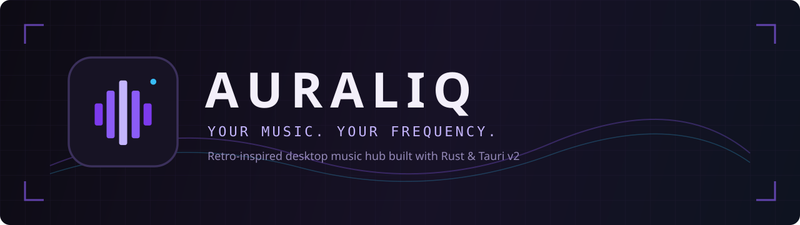

# Auraliq

> **Your music. Your frequency.**

[](LICENSE)
[](#supported-platforms)
[](ROADMAP.md)

A retro-inspired unified music hub built with **Rust + Tauri v2** for local music libraries, compliant online playback, playlists, permitted downloads, and deep UI customization.

---

## What Is Auraliq?

Auraliq combines the usability of a modern desktop music player with the freedom of a local-first library, modular music source providers, and a customizable retro interface inspired by 1990s audio software, vintage hardware, and CRT displays.

## Why Auraliq Exists

Many modern music apps rely on intrusive advertisements, fragmented ecosystems, rigid interfaces, and limited user control. Auraliq puts the listener back in control—prioritizing personal music ownership, transparent platform capabilities, zero in-app ads, and open customization without claiming to bypass paid subscriptions or platform restrictions.

---

## Features

### Available (v0.1.0 — Milestone 2 Design System & Shell)

- Tauri v2 + Rust (`x86_64-pc-windows-msvc`) + React 19 + TypeScript desktop shell
- Typed Tauri IPC bridge (`get_app_info`) with graceful browser preview fallback
- Brand identity assets (`branding/`), custom app icons, and retro `--aq-*` design tokens
- 5 built-in themes (`Midnight Cassette`, `CRT Purple`, `Analog Amber`, `Retro Terminal`, `Classic Gray`) with Reduced Motion toggle
- Collapsible sidebar, optional right context panel (`Queue`, `Info`, `Scope`), and persistent bottom player deck shell (transport controls honestly disabled until Milestone 4)
- Strict Tauri capabilities, restrictive CSP, and automated CI checks

### In Development

- Customizable sidebar ordering, persistent layout state, and keyboard shortcuts (Milestone 3)
- Local audio engine (`symphonia` + `cpal` + `rubato`) & SQLite/FTS5 library scanner (Milestone 4)

### Planned

- Windows SMTC/media keys, Canvas FFT visualizers, unified track identity, modular online providers (Internet Archive, Radio Browser, Direct URLs), download manager, LRU cache, live CSS editor, and NSIS/Portable Windows releases.

### Not Supported (By Design / Legal Compliance)

- Downloading, ripping, or offline caching from YouTube, Spotify, or SoundCloud
- Bypassing DRM, paywalls, or subscription tiers
- WMA audio decoding (unsupported by `symphonia`)

---

## Supported Platforms

| Platform              | Status             | Notes                                         |
| --------------------- | ------------------ | --------------------------------------------- |
| Windows 10 / 11 (x64) | **Primary Target** | Foundation builds on `x86_64-pc-windows-msvc` |
| Linux / macOS         | Future             | Planned after Windows MVP (`1.0.0`)           |

---

## Supported Music Sources

| Source                  | Search            | Playback            | Download            | Offline             | Status              |
| ----------------------- | ----------------- | ------------------- | ------------------- | ------------------- | ------------------- |
| Local Library           | Planned (M4)      | Planned (M4)        | N/A                 | Planned (M4)        | Tier 1 — MVP Core   |
| Internet Archive        | Planned (M8)      | Planned (M8)        | Planned (M8)        | Planned (M9)        | Tier 2 — MVP Online |
| Radio Browser           | Planned (M8)      | Planned (M8)        | No (Live Radio)     | No                  | Tier 2 — MVP Online |
| Direct Audio URLs / RSS | N/A               | Planned (M8)        | Conditional         | Conditional         | Tier 2 — MVP Online |
| YouTube / Spotify       | Optional (Tier 3) | Restricted Official | **No** (Prohibited) | **No** (Prohibited) | Post-MVP Optional   |

See [docs/providers/PROVIDER_COMPATIBILITY.md](docs/providers/PROVIDER_COMPATIBILITY.md) for the full compliance matrix.

---

## Development

See [docs/development/BUILDING.md](docs/development/BUILDING.md) for prerequisites and build commands.

```powershell
pnpm install
pnpm build
pnpm tauri dev
```

## Roadmap

See [ROADMAP.md](ROADMAP.md) for all milestones (`0.1.0` → `1.0.0` MVP).

## Contributing

Contributions are welcome! Please read [CONTRIBUTING.md](CONTRIBUTING.md) first.

## Privacy

Auraliq collects **zero telemetry** by default, never uploads local library data, and stores optional provider credentials in Windows Credential Manager (`keyring`). See [SECURITY.md](SECURITY.md).

## License

Licensed under the [MIT License](LICENSE).
