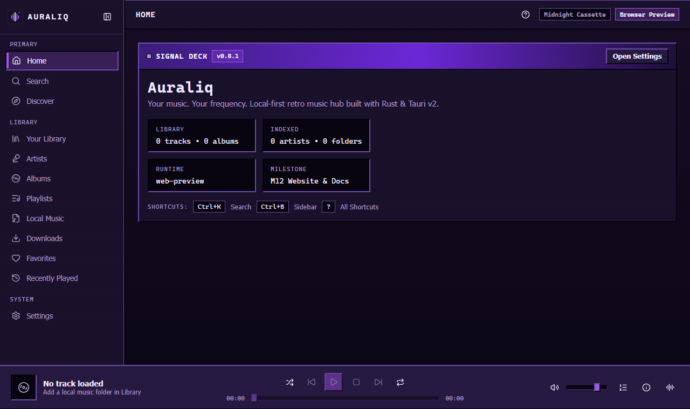

# Auraliq

> **Your music. Your frequency.**

[](LICENSE)
[](#supported-platforms)
[](ROADMAP.md)
[](https://justypixels.github.io/auraliq/)

A retro-inspired unified music hub built with **Rust + Tauri v2** for local music libraries, compliant online playback, playlists, permitted downloads, and deep UI customization.

---

## Screenshots



---

## What Is Auraliq?

Auraliq combines the usability of a modern desktop music player with the freedom of a local-first library, modular music source providers, and a customizable retro interface inspired by 1990s audio software, vintage hardware, and CRT displays.

## Why Auraliq Exists

Many modern music apps rely on intrusive advertisements, fragmented ecosystems, rigid interfaces, and limited user control. Auraliq puts the listener back in control—prioritizing personal music ownership, transparent platform capabilities, zero in-app ads, and open customization without claiming to bypass paid subscriptions or platform restrictions.

---

## Features

### Available (v0.9.0 — Milestone 13 QA, Optimization & Security)

- **Audio DSP & Playback Enhancements**: 5-band biquad Equalizer with 6 presets, ReplayGain normalization, **Gapless Playback**, and **Crossfade (0–8s)**
- **Opt-In Synced & Local Lyrics**: Automatic offline `.lrc` sidecars + optional opt-in LRCLIB synced/plain lyrics with click-to-seek
- **5 Retro Hardware Visualizers**: Segmented 90s LED Bars, CRT Scope, Cassette Deck, **Dual Analog VU Meters**, and **CRT Matrix**
- **1990s Retro Purplish Deck UI**: Zero-radius beveled panels, 3D hardware buttons, gradient titlebars, square LEDs, and subtle CRT scanlines
- **Theme Editor & Safe Live CSS**: Live 10-color palette overrides, typography presets, bevel style (`90s 3D Bevel` / `Flat Pixel`), scanline slider, sanitized `<style id="auraliq-user-css">` live CSS editor, JSON theme import/export, and Safe Reset
- **Source-Aware Download Manager**: Permitted downloads for open/CC sources (Internet Archive, artist-approved Jamendo tracks) with pause/resume (`Range`), retry/cancel, concurrency control, naming templates, `lofty` auto-tagging, and auto-import to the local library
- **LRU Temporary Playback Cache**: Strictly separated stream cache (`offline_cache_allowed` sources only) with configurable size limit, TTL expiration, automatic cleanup, and **Offline Mode**
- **Zero-Config Online Music**: **Audius** (trending & search, free 320kbps streaming), **Internet Archive** (open archival audio), **Radio Browser** (global live radio), and **Direct Audio URLs**
- **Bring-Your-Own-Key (BYOK) Providers**: **Jamendo** (CC catalog), **Freesound** (CC ambient/synth stems), and **YouTube** (Data API v3 search + external watch handoff) stored in Windows Credential Manager
- Dedicated-thread Rust audio engine (`symphonia` + `cpal` + stereo resampler) supporting local files and validated HTTP audio streams
- Windows SMTC & hardware media keys (`souvlaki`), CPAL audio output device selection, and automatic stream error recovery
- SQLite (`rusqlite` + WAL + FTS5) local library, `lofty` metadata/artwork, M3U/M3U8/PLS playlists, smart playlists, custom collections, duplicate detection, and non-destructive track identity matching
- 5 built-in retro themes, UI density, resizable/customizable sidebar, and rebindable keyboard shortcuts

### In Development

- Windows NSIS Installer & Portable ZIP MVP Release (Milestone 14)

### Planned

- Windows NSIS Installer & Portable ZIP MVP Release with SHA-256 Checksums (Milestone 14)

### Not Supported (By Design / Legal Compliance)

- Downloading, ripping, or offline caching from YouTube, Spotify, or SoundCloud
- Bypassing DRM, paywalls, or subscription tiers
- WMA audio decoding (unsupported by `symphonia`)

---

## Supported Platforms

| Platform              | Status             | Notes                                         |
| --------------------- | ------------------ | --------------------------------------------- |
| Windows 10 / 11 (x64) | **Primary Target** | Foundation builds on `x86_64-pc-windows-msvc` |
| Linux / macOS         | Future             | Planned after Windows MVP (`1.0.0`)           |

---

## Supported Music Sources

| Source               | Search     | Playback            | Download            | Offline             | Status             |
| -------------------- | ---------- | ------------------- | ------------------- | ------------------- | ------------------ |
| Local Library        | Yes (FTS5) | Yes (Symphonia)     | N/A                 | Yes                 | **Supported (M4)** |
| Audius               | Yes        | Yes (320kbps)       | **No**              | Allowed (LRU, M9)   | **Supported (M8)** |
| Internet Archive     | Yes        | Yes (Stream)        | Permitted (M9)      | Allowed (LRU, M9)   | **Supported (M8)** |
| Radio Browser        | Yes        | Yes (Live Radio)    | **No** (Live Radio) | **No**              | **Supported (M8)** |
| Direct Audio URLs    | N/A        | Yes (HTTPS)         | **No**              | **No**              | **Supported (M8)** |
| Jamendo (BYOK Key)   | Yes        | Yes (CC MP3)        | Artist-Permitted    | Allowed (LRU, M9)   | **Supported (M8)** |
| Freesound (BYOK Key) | Yes        | Yes (CC Previews)   | **No**              | Allowed (LRU, M9)   | **Supported (M8)** |
| YouTube (BYOK Key)   | Yes        | External Watch Only | **No** (Prohibited) | **No** (Prohibited) | **Optional (M8)**  |
| Spotify              | Limited    | Restricted Official | **No** (Prohibited) | **No** (Prohibited) | Post-MVP Optional  |

See [docs/providers/PROVIDER_COMPATIBILITY.md](docs/providers/PROVIDER_COMPATIBILITY.md) for the full compliance matrix.

---

## Development

See [docs/development/BUILDING.md](docs/development/BUILDING.md) for prerequisites and build commands.

```powershell
pnpm install
pnpm build
pnpm tauri dev
```

## Roadmap

See [ROADMAP.md](ROADMAP.md) for all milestones (`0.1.0` → `1.0.0` MVP).

## Contributing

Contributions are welcome! Please read [CONTRIBUTING.md](CONTRIBUTING.md) first.

## Privacy

Auraliq collects **zero telemetry** by default, never uploads local library data, and stores optional provider credentials in Windows Credential Manager (`keyring`). See [SECURITY.md](SECURITY.md).

## License

Licensed under the [MIT License](LICENSE).
