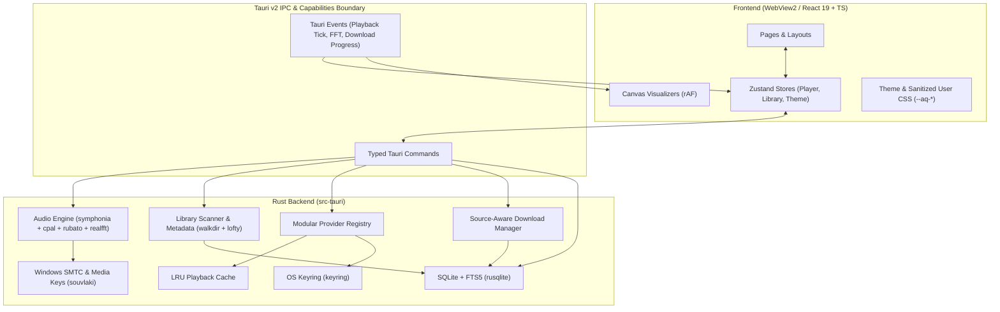
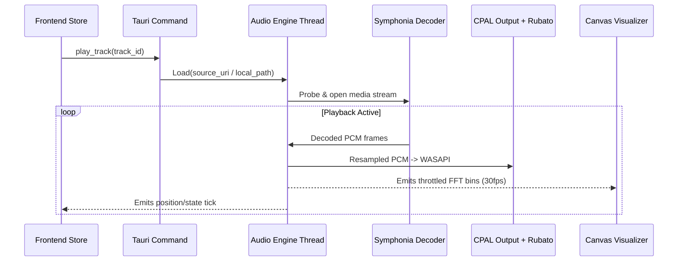

# Auraliq — Architecture Proposal

> **Status**: Milestone 0 Proposal (Approved for Milestone 1 Foundation)  
> **Stack**: Tauri v2 + Rust (MSVC on Windows x64) + React 19 + TypeScript + Vite + SQLite (`rusqlite`)

---

## 1. High-Level System Architecture



---

## 2. Repository Directory Structure

```text
auraliq/
├── src/                        # React 19 + TypeScript frontend
│   ├── app/                    # App bootstrap, router, error boundary
│   ├── components/             # Reusable retro UI primitives
│   ├── layouts/                # Main shell (sidebar, content, right panel, player bar)
│   ├── pages/                  # Home, Search, Discover, Library, Playlists, Downloads, Settings
│   ├── player/                 # Player controls & queue UI
│   ├── library/                # Track/Album/Artist/Genre views (TanStack Virtual)
│   ├── playlists/              # Playlist & smart playlist views, M3U/PLS UI
│   ├── providers/              # Provider badges, capability-aware UI, auth/settings cards
│   ├── themes/                 # Built-in themes & JSON theme schema
│   ├── customization/          # Theme & CSS editor, layout customizer
│   ├── visualizers/            # Canvas spectrum, oscilloscope, cassette reel
│   ├── hooks/                  # Typed Tauri command/event hooks
│   ├── stores/                 # Zustand state stores
│   ├── types/                  # Shared TS interfaces mirroring Rust DTOs
│   └── styles/                 # Base reset, retro tokens (--aq-*), layouts
├── src-tauri/
│   ├── src/
│   │   ├── main.rs             # Binary entry
│   │   ├── lib.rs              # Tauri builder, plugin & state setup
│   │   ├── commands/           # Thin IPC command handlers
│   │   ├── audio/              # Symphonia decoder, CPAL output, Rubato, FFT, queue
│   │   ├── library/            # Folder scanner, missing-file & duplicate detection
│   │   ├── metadata/           # Lofty tag/artwork extraction & track matching
│   │   ├── providers/          # MusicProvider trait, registry, individual adapters
│   │   ├── downloads/          # Queue, Range resume, atomic file writes, tagging
│   │   ├── cache/              # Temporary LRU audio/artwork cache
│   │   ├── database/           # rusqlite connection, WAL, FTS5, migrations
│   │   ├── settings/           # Persistent app/layout/keybind config
│   │   ├── security/           # keyring wrapper, URL/path validation
│   │   └── platform/           # Windows SMTC (souvlaki) & OS integrations
│   ├── capabilities/           # Least-privilege Tauri v2 capability JSONs
│   ├── icons/                  # App & installer icons
│   └── tauri.conf.json
├── docs/                       # Research, architecture, providers, project state
├── branding/                   # Logo, icons, banners, screenshots
├── website/                    # Static retro landing/docs site (GitHub Pages)
├── .github/workflows/          # CI, release bundler, GitHub Pages deploy
├── ROADMAP.md
├── CHANGELOG.md
└── README.md
```

---

## 3. Audio Playback Pipeline



- **Thread Isolation**: Audio decoding and CPAL callback run on dedicated Rust threads with lock-free/bounded ring buffers so UI interactions never cause audio dropouts.
- **Error Recovery**: Corrupted frames, missing files, or disconnected audio devices emit structured `AudioError` events to the UI with human-readable messages and expandable diagnostics.

---

## 4. Modular Provider Architecture

Every music source implements a unified Rust trait and declares an explicit `ProviderCapabilities` profile. The frontend queries capabilities at runtime and **disables or hides unsupported actions**—never rendering fake buttons.

```rust
pub struct ProviderCapabilities {
    pub search: bool,
    pub metadata: bool,
    pub stream_playback: bool,
    pub external_playback_only: bool,
    pub playback_control: bool,
    pub playlists: bool,
    pub download: bool,
    pub offline_cache_allowed: bool,
    pub lyrics: bool,
    pub requires_auth: bool,
}
```

- **Local Library Provider** (`local`): First-class offline source (`download = false` / N/A, `offline_cache_allowed = false` since files are already local).
- **Online Providers**: Registered in `ProviderRegistry` by `provider_id` (`internet_archive`, `radio_browser`, `direct_url`, `jamendo`, `audius`, optional `youtube`, optional `spotify`).

---

## 5. Database & Unified Track Identity

- **Engine**: SQLite via `rusqlite` (`bundled`, `PRAGMA journal_mode=WAL;`, `PRAGMA foreign_keys=ON;`).
- **Core Tables**:
  - `tracks` (id, source_provider, source_id, file_path, title, artist, album, album_artist, genre, duration_ms, track_num, disc_num, release_year, format, bitrate, sample_rate, artwork_hash, file_size, mtime, play_count, last_played_at, is_favorite, added_at)
  - `tracks_fts` (FTS5 virtual table on title, artist, album, genre)
  - `albums`, `artists`, `library_folders`
  - `playlists`, `playlist_items`, `smart_playlists`
  - `track_identities` & `track_identity_links` (links local + online representations via normalized title/artist + duration tolerance without ever merging distinct versions like live/remix/cover)
  - `downloads`, `cache_entries`, `playback_history`, `settings`
- **Migrations**: Versioned `PRAGMA user_version` / `_migrations` table executed atomically at startup.

---

## 6. Security & Customization Boundaries

1. **Secrets**: Stored exclusively via `keyring` (Windows Credential Manager). Never written to SQLite, logs, or frontend state.
2. **Filesystem & Downloads**: Canonicalize paths and reject `..` traversal; validate download URLs (`https://` only, allowed MIME/extensions, size limits).
3. **Custom CSS**: User CSS is scoped to styling variables and selectors inside `<style id="auraliq-user-css">`. No user JS execution; strict Tauri CSP prevents script injection. Always provide a Safe Reset shortcut.

---

## 7. Risk Analysis & Mitigations

| Risk | Severity | Mitigation |
|---|---|---|
| **Windows GNU vs MSVC toolchain mismatch** | High | Pin `x86_64-pc-windows-msvc` in `rust-toolchain.toml`; verify in CI on `windows-latest`. |
| **Provider API deprecation / ToS changes** | High | Isolate each provider behind `MusicProvider`; keep Local Library + open sources (Internet Archive, Radio Browser) as core MVP; never depend on scraping. |
| **Audio stutter during large library scans** | Medium | Run `walkdir` + `lofty` on background worker threads with batched SQLite transactions; keep audio thread isolated. |
| **User CSS breaking app navigation/visibility** | Medium | Provide one-click "Reset CSS / Safe Mode" hotkey & settings button; never allow JS in themes. |
| **WMA or proprietary codec failure** | Low | Document supported formats clearly; surface clean "Unsupported format (WMA)" diagnostic in UI. |
